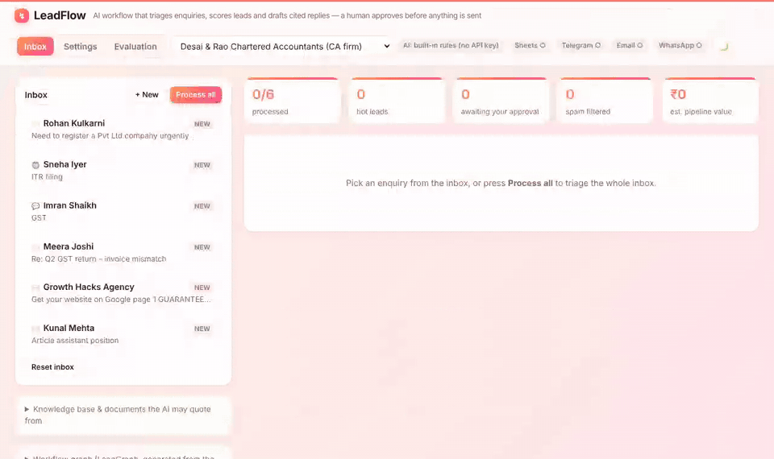

# LeadFlow: an AI enquiry workflow for small businesses

Small businesses such as CA firms, clinics, coaching classes and salons get enquiries on email, web forms and WhatsApp. They tend to reply late, miss the urgent ones and never follow up.

LeadFlow is a **LangGraph** workflow that reads each enquiry and works through it:
- It **screens it for prompt injection** and **classifies** it.
- It **extracts** the lead details and **scores** the lead.
- It **searches the business's own documents (RAG)** and **drafts a reply with citations**.
- It **checks the reply** for invented prices or offers.
- It **pauses for the owner to approve**.

After approval, it logs the lead to **Google Sheets**, alerts the team on **Telegram** and replies by **email or WhatsApp**, all three in parallel. If the customer goes quiet, it drafts a **follow-up**.

**Live demo:** https://leadflow-ai-two-sooty.vercel.app · Built with LangGraph, LangChain, Groq, FastAPI, Supabase and vanilla JS, deployed on Vercel.



## What it does

| Step | Node | How |
|---|---|---|
| Safety | `guard` | Rule-based prompt-injection screen ("ignore previous instructions", fake `<system>` tags, "confirm 90% off"). Flagged messages are marked for a human, and every prompt wraps the customer's text in `<customer_message>` tags as data. |
| Triage | `classify` | Sales / support / partnership / job application / spam, plus language (English or Hinglish) and confidence. LLM with structured output, with a rules fallback. |
| Spam filter | `archive` | Only **confident** spam is archived automatically; unsure "spam" goes to a human. |
| Lead details | `extract` | Name, phone, email, which of *our* services they need, budget in ₹ (`20k`, `1.5 lakh`), and timeline. Regex covers phone and budget so the LLM can't invent them. |
| Lead score | `score` | 0–100 with a reason for every point, giving hot/warm/cold. Rule-based on purpose, so it's explainable. |
| RAG | `retrieve` | BM25 search over the business's documents (fee sheets, policies, FAQs, as PDF/TXT/MD), returning the top sections with relevance scores. |
| Reply | `draft_reply` | Grounded in the knowledge base and retrieved sections, cites them as `[1]` `[2]`, and replies in the customer's language. |
| Guardrail | `check_reply` | Blocks any number or offer ("free…", "20% discount") that isn't in the knowledge base, the documents or the customer's own message, plus over-promising. Failing drafts go back to the LLM with the issues listed: a **self-correction loop**. |
| Human in the loop | `human_review` | The graph **pauses**. A "needs a closer look" banner shows why when something is off (low confidence, injection, no service matched). The owner can approve, edit, ask the AI to revise, or reject. |
| Actions | `log_to_sheet` ‖ `notify_team` ‖ `send_reply` | Run **in parallel** (LangGraph fan-out), then `finalize` waits for all three. |
| Follow-up | `/api/followup` | Drafts a polite nudge 48 hours after the reply, passed through the same check, and sent only after approval. |

```
ingest → guard → classify ─(confident spam)→ archive → END
                          └→ extract → score → retrieve → draft_reply → check_reply ─(issues, retry)→ draft_reply
                                                                                    └→ [pause] human_review
human_review ─approve→ log_to_sheet | notify_team | send_reply → finalize → END
             ─revise──→ draft_reply
             ─reject──→ archive → END
```

## Evaluation

Run `python scripts/eval.py` (uses the LLM if `GROQ_API_KEY` is set) or `python scripts/eval.py --rules`. The results also appear on the dashboard's **Evaluation** tab.

The test data is two sets:
- `evals/cases.jsonl`: **50 hand-labelled enquiries** across the 3 demo businesses. They include English and Hinglish, spam, support, job and partnership mails, and prompt-injection attempts, and were labelled before the system was run on them.
- `evals/reply_cases.jsonl`: **16 replies** labelled "should pass" or "should be blocked".

| Metric (rules mode, no LLM) | First run | Now |
|---|---|---|
| Category accuracy | 100% | 100% |
| Spam precision / recall | 100% / 100% | 100% / 100% |
| Service extraction F1 | 90.9% | 90.9% |
| Budget / phone accuracy | 100% / 100% | 100% / 100% |
| Timeline accuracy | 93.2% | 93.2% |
| Prompt-injection attempts flagged (false alarms) | 100% (0) | 100% (0) |
| Reply check blocks bad replies | **75%** | **100%** |
| Reply check passes good replies | **87.5%** | **100%** |

The first run found three real gaps in the guardrail:
- It allowed "ITR filing is free for you" because "free" appeared elsewhere in the facts. Offers are now matched as phrases.
- It ignored single-digit claims like "2 days". Every number is now checked, and `[1]` citations are skipped.
- A plural-folding bug stopped "batches" from matching "batch". This was fixed in the retriever.

The fixes are general rules; no test cases were special-cased. The rules and this test set were written by the same person, so treat the rules column as optimistic. Running the LLM column is the independent check (`evals/report_llm.json`).

## Design decisions (and why)

- **LLM for language, rules for judgement.** The LLM classifies, extracts and writes. The injection guard, scoring and the reply check are deterministic and tested, so the model can't argue its way past them.
- **Every LLM node has a fallback.** With no key, or if Groq fails, each node falls back to rules and the trace marks it `rules`. The demo always works.
- **RAG with BM25, not embeddings (for now).** There's no model download and no vector database, so the serverless function stays small and the relevance scores are easy to explain. Swapping in embeddings only means replacing `Retriever.search`.
- **Nothing is sent without a human.** Integrations without keys run as **simulated** and show exactly what they would send.
- **Stateless human-in-the-loop for serverless.** The paused state travels to the browser in an **HMAC-signed token**. Resume rebuilds the graph and re-seeds it with `update_state(..., as_node="check_reply")`. A tampered token gets a 400. Documents travel through the run *config*, not the state, so the token stays small.
- **Parallel side effects** use `operator.add` reducers on `actions`, `trace` and `needs_human`.

## Use it for a real business

1. **Settings tab → Your business.** Enter the services and prices, FAQs, hours and a rule the AI must follow, and upload documents (PDF/TXT/MD). Everything is stored in your browser.
2. **Real intake (optional, server-side):**
   - Create a Supabase project and run `scripts/supabase_schema.sql`. Then set `SUPABASE_URL`, `SUPABASE_SERVICE_KEY`, `INTAKE_KEY` and `ADMIN_TOKEN` in Vercel and redeploy.
   - In **Settings → Real intake**, enter the admin token and a business id, then press *Save my business to the server*.
   - **Gmail:** paste `scripts/gmail_intake.gs` into script.google.com, set the constants and run `setup`. New inbox mail is sent to LeadFlow every 5 minutes.
   - **Website:** paste `scripts/website_form.html` into the site.
   - **WhatsApp:** in Meta for Developers, point the webhook to `https://<your-app>/api/whatsapp`. Set `WHATSAPP_VERIFY_TOKEN`, `WHATSAPP_APP_SECRET`, `WHATSAPP_TOKEN`, `WHATSAPP_PHONE_ID` and `WHATSAPP_BUSINESS_ID`. Replies to WhatsApp leads go back on WhatsApp.
   - New enquiries arrive in the **📥 Live inbox** (business selector), and Telegram pings you when one is waiting.
3. **Outputs:** `GOOGLE_SHEETS_WEBHOOK_URL` (deploy `scripts/sheets_webhook.gs`), `TELEGRAM_BOT_TOKEN` + `TELEGRAM_CHAT_ID`, and `RESEND_API_KEY` + `FROM_EMAIL`. See `.env.example`.

## Run it locally

```bash
python -m venv .venv && .venv/bin/pip install -r requirements-dev.txt     # Windows: .venv\Scripts\pip
.venv/bin/python -m pytest -q                                             # 57 tests, no network needed
.venv/bin/python scripts/eval.py --rules                                  # evaluation report
.venv/bin/uvicorn app:app --reload                                        # http://127.0.0.1:8000
```

## API

| Method | Path | |
|---|---|---|
| `POST` | `/api/run` | `{enquiry, profile_id, profile?, docs?, tone}`. Runs until the pause; returns `state` and a signed `token` |
| `POST` | `/api/resume` | `{token, decision: approve\|revise\|reject, feedback?, edited_reply?, lead_id?}`; approved leads also get a `done_token` |
| `POST` | `/api/followup`, `/api/followup/send` | Drafts and sends a follow-up for a `done_token` |
| `POST` | `/api/extract-text` | PDF/TXT/MD upload, returned as text for RAG |
| `POST` | `/api/intake` | Real enquiries (`X-Intake-Key`): run, store, Telegram ping |
| `GET` | `/api/leads` · `POST /api/business` | Live inbox and saved businesses (`X-Admin-Token`, Supabase) |
| `GET/POST` | `/api/whatsapp` | Meta webhook verification and signed incoming messages |
| `GET` | `/api/meta`, `/api/health`, `/api/eval` | Profiles, samples and graph; config status; evaluation reports |

## Project layout

```
app.py                     FastAPI app (Vercel detects it automatically)
leadflow/graph.py          LangGraph nodes, routers, build_graph(), start(), resume()
leadflow/rules.py          Injection guard, rule-based classify / extract / score / draft, check_reply
leadflow/retriever.py      Markdown section splitter + BM25 retriever (RAG)
leadflow/profiles.py       3 demo businesses, 16 samples, Profile schema for custom businesses
leadflow/docs/<business>/  Demo documents the RAG step searches
leadflow/integrations.py   Google Sheets, Telegram, Resend, WhatsApp: live or simulated
leadflow/storage.py        Optional Supabase storage (PostgREST over httpx)
leadflow/followup.py       Follow-up drafts
evals/                     Labelled cases, reply-check cases, reports
scripts/                   eval.py, Supabase schema, Gmail / Sheets Apps Scripts, website form
public/index.html          Dashboard: inbox, settings, evaluation, dark mode
tests/test_leadflow.py     57 tests: routing, guardrails, RAG, HITL, intake, WhatsApp signature, eval regression
```

The demo businesses and every customer in the samples are fictional.

Built by **Niket Korgaonkar** · [GitHub](https://github.com/NiKeT972)
