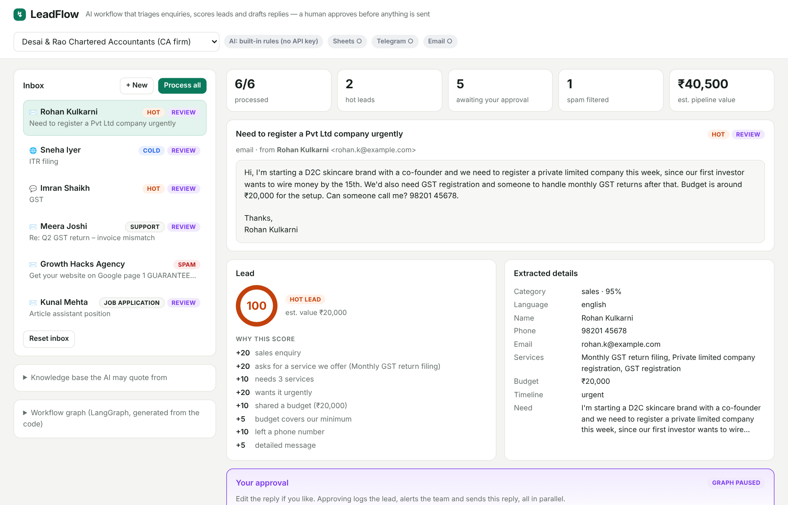

# LeadFlow: an AI enquiry workflow for small businesses

Small businesses such as CA firms, clinics and coaching classes get enquiries from email, web forms and WhatsApp. They tend to reply late, miss the urgent ones and lose track of leads.

LeadFlow is a **LangGraph** workflow that reads each incoming enquiry, **classifies** it, **extracts** the lead details, **scores** the lead, **drafts a reply** grounded in the business's own price list and **checks** that the reply invents nothing. It then **pauses for the owner to approve**. Once approved, it logs the lead to **Google Sheets**, alerts the team on **Telegram** and **emails the reply**, all three in parallel.



**Live demo:** _link added after deploy_ · Built with LangGraph, LangChain, Groq, FastAPI and vanilla JS, deployed on Vercel.

## What it does

| Step | Node | How |
|---|---|---|
| Triage | `classify` | Sales / support / partnership / job application / spam, plus language (English or Hinglish). LLM with structured output, with a keyword-rules fallback. |
| Spam filter | `archive` | Spam leaves the graph immediately, so nobody spends time on it and no reply is sent. |
| Lead details | `extract` | Name, phone, email, which of *our* services they need, budget in ₹ (understands `20k`, `1.5 lakh`), and timeline. Regex covers phone and budget so the LLM can't invent them. |
| Lead score | `score` | 0–100 with a reason for every point (urgent +20, budget shared +10, …), giving hot/warm/cold. Rule-based on purpose, so it's explainable. |
| Reply | `draft_reply` | Grounded in the business's knowledge base (services, prices, hours, FAQs). Replies in the customer's language. |
| Guardrail | `check_reply` | Rejects any number that isn't in the knowledge base or the customer's message (no invented prices, discounts or dates) and any over-promising ("guaranteed", "100%"). Failing drafts are sent back to the LLM with the issues listed: a **self-correction loop**. |
| Human in the loop | `human_review` | The graph **pauses**. The owner can approve, edit then approve, ask the AI to revise ("make it formal"), or reject. |
| Actions | `log_to_sheet` ‖ `notify_team` ‖ `send_reply` | Run **in parallel** (LangGraph fan-out), then `finalize` waits for all three. |

```
ingest → classify ─(spam)→ archive → END
                 └→ extract → score → draft_reply → check_reply ─(issues, retry)→ draft_reply
                                                               └→ [pause] human_review
human_review ─approve→ log_to_sheet | notify_team | send_reply → finalize → END
             ─revise──→ draft_reply
             ─reject──→ archive → END
```

The dashboard also renders the real graph, generated from the code with `draw_mermaid()`.

## Design decisions (and why)

- **LLM for language, rules for judgement.** The LLM classifies, extracts and writes. Scoring and the reply check are deterministic, so the owner can see *why* a lead is hot, and the model can't argue its way past the guardrail.
- **Every LLM node has a fallback.** With no API key, or if Groq fails, each node falls back to rules and the trace marks it `rules` instead of `llm`. The demo always works.
- **Nothing is sent without a human.** Replies go out only after approval. Integrations without keys run as **simulated** and show exactly what they would have sent, so the public demo never emails a stranger.
- **Stateless human-in-the-loop for serverless.** On Vercel each request may hit a fresh instance, so the paused state goes to the browser inside an **HMAC-signed token** (`leadflow/state_token.py`). Resume rebuilds the graph, re-seeds that state with `update_state(..., as_node="check_reply")` and continues. A tampered token gets a 400, so nobody can swap in a reply that skipped the check.
- **Parallel side effects.** The three actions write to the same `actions` and `trace` lists at once, so those keys use an `operator.add` reducer.

## Run it locally

```bash
python -m venv .venv && .venv/bin/pip install -r requirements-dev.txt     # Windows: .venv\Scripts\pip
.venv/bin/python -m pytest -q                                             # 39 tests, no network needed
.venv/bin/uvicorn app:app --reload                                        # http://127.0.0.1:8000
```

Copy `.env.example` to `.env` and add whichever keys you have. All of them are optional:

| Variable | Turns on |
|---|---|
| `GROQ_API_KEY` (+ optional `GROQ_MODEL`) | The LLM for classify, extract and draft (default `openai/gpt-oss-120b`) |
| `STATE_SIGNING_KEY` | A private key for the paused-state token (set this in production) |
| `GOOGLE_SHEETS_WEBHOOK_URL` | Real Sheets logging; deploy `scripts/sheets_webhook.gs` as an Apps Script web app |
| `TELEGRAM_BOT_TOKEN`, `TELEGRAM_CHAT_ID` | Real Telegram alerts |
| `RESEND_API_KEY`, `FROM_EMAIL` | Real reply emails via Resend |

## API

| Method | Path | |
|---|---|---|
| `POST` | `/api/run` | `{enquiry:{channel, from_name, from_email, subject, body}, profile_id, tone}`. Runs until the pause; returns `state`, `paused_at` and the signed `token` |
| `POST` | `/api/resume` | `{token, decision: approve\|revise\|reject, feedback?, edited_reply?}` |
| `GET` | `/api/meta` | Business profiles, sample enquiries and the Mermaid graph |
| `GET` | `/api/health` | LLM mode, model and which integrations are live |

## Project layout

```
app.py                     FastAPI app (Vercel detects it automatically)
leadflow/graph.py          LangGraph nodes, routers, build_graph(), start(), resume()
leadflow/rules.py          Rule-based classify / extract / score / draft / check_reply
leadflow/profiles.py       3 demo businesses (knowledge base) + 16 sample enquiries
leadflow/integrations.py   Google Sheets, Telegram, Resend: live or simulated
leadflow/llm.py            ChatGroq or None
leadflow/state_token.py    HMAC-signed paused state
public/index.html          Dashboard (inbox, lead card, approval panel, trace)
tests/test_leadflow.py     Routing, guardrail, HITL paths, LLM self-correction with a stub model, API
```

## Ideas for next steps

- Real intake: a Gmail or WhatsApp Business webhook, plus a database (Supabase/Postgres) so leads persist server-side
- A follow-up node that nudges warm leads after 48 hours with no reply
- RAG over a larger document set per business instead of a short knowledge base

The demo businesses and every customer in the samples are fictional.

Built by **Niket Korgaonkar** · [GitHub](https://github.com/NiKeT972)
